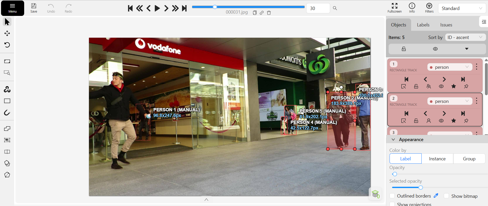
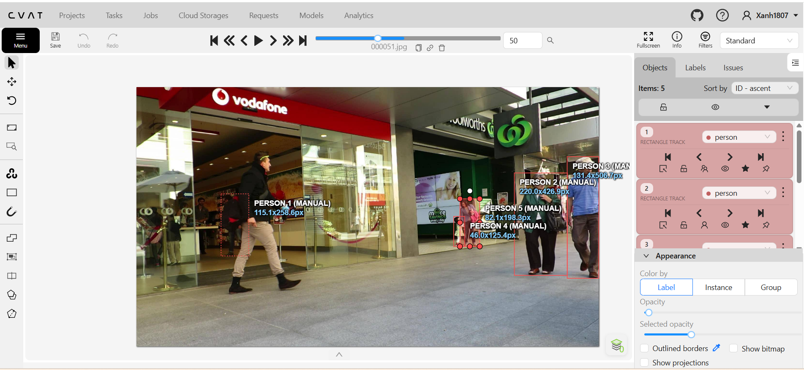

# Báo cáo cá nhân — NguyenXuanAnh-2A202603101

Đoạn video: MOT17-09, 150 frame (frame 1–150), nguồn MOTChallenge, giấy phép CC BY-NC-SA 3.0.

## 0. Thông tin học viên

- Họ tên: Nguyễn Xuân Anh
- MSSV: 2A202603101
- Mã đề (A/B/C): B
- Email: 26ai.anhnx@vinuni.edu.vn
- Link repository: https://github.com/VinUni-AI20k/K5-L2-DAY05-NguyenXuanAnh-2A202603101-MOTTracking
- Giờ bắt đầu: 17:00
- Giờ kết thúc: 18:30

## 1. Xem trước đoạn video (CP0)

Ghi **trước khi vẽ**, mỗi người một dòng.

| Mã | Frame xuất hiện | Frame cuối thấy được | Rẽ / dừng / đổi tốc độ ở frame | Bị che ở frame | Ghi chú |
|---|---|---|---|---|---|
| P1 | 0 | 149 | ~30 | 30–49 | Bị che bởi vật thể khác, khuất 10 frame (frame 40–49) |
| P2 | 0 | 149 | — | — | Đi thẳng đều suốt đoạn |
| P3 | 0 | 149 | — | — | Đi thẳng đều suốt đoạn |
| P4 | 0 | 149 | ~80 | — | Thay đổi hướng/tốc độ quanh frame 80 |
| P5 | 0 | 149 | ~80 | — | Thay đổi tốc độ quanh frame 80 |

## 2. Keyframe và thời gian (CP1, CP4)

Số keyframe lấy từ kết quả `src/check_submission.py`.

| Mã | Số keyframe | Keyframe ở frame | Số frame có mặt | Keyframe / 100 frame | Thời gian (phút) | Chỗ khó |
|---|---|---|---|---|---|---|
| P1 | 15 | 0, 10, 20, 30, 50, 60, 70, 80, 90, 100, 110, 120, 130, 140, 149 | 140 | 10.7 | ~10 | Đoạn bị che frame 40–49, cần occluded + outside |
| P2 | 16 | 0, 10, 20, 30, 40, 50, 60, 70, 80, 90, 100, 110, 120, 130, 140, 149 | 150 | 10.7 | ~10 | Đi thẳng, ít khó |
| P3 | 16 | 0, 10, 20, 30, 40, 50, 60, 70, 80, 90, 100, 110, 120, 130, 140, 149 | 150 | 10.7 | ~10 | Đi thẳng, ít khó |
| P4 | 10 | 0, 10, 20, 30, 40, 50, 60, 70, 80, 140 | 150 | 6.7 | ~10 | Đổi hướng quanh frame 80 |
| P5 | 10 | 0, 10, 20, 30, 40, 50, 80, 90, 100, 139 | 150 | 6.7 | ~10 | Đổi tốc độ quanh frame 80 |
| **Tổng** | **67** | — | **740** | **9.1** | ~50 | |

Keyframe / 100 frame của cả bài = 67 ÷ 740 × 100 = **9.1 keyframe / 100 frame**

Bạn đặt keyframe nhiều nhất ở người nào? Vì sao (người đó rẽ, dừng, lại gần camera hay bị che)?

P1 và P2/P3 đều có 15–16 keyframe. P1 cần nhiều keyframe hơn vì phải xử lý đoạn bị che (occluded + outside), cần đặt keyframe ngay trước và sau đoạn khuất để nội suy không bị sai. P2 và P3 đặt keyframe đều mỗi 10 frame vì đi thẳng tương đối đều, cần kiểm thường xuyên.

## 3. Đoạn bị che (CP2)

Người bị che: `P1`

| Mốc | Frame |
|---|---:|
| Bắt đầu bị che một phần (bật `occluded`) | ~30 |
| Mất hẳn (bật `outside`) | 40 |
| Hiện lại (tắt `outside`) | 50 |
| Thấy rõ trở lại (tắt `occluded`) | ~50 |

- Thời gian khuất hẳn: **10 frame = 0.33 giây**.
- Quyết định: **giữ cùng ID**.
- Lý do (trả lời 3 câu: khuất bao lâu so với 60 frame, ngoại hình có khớp, chỗ hiện lại có đúng hướng và tốc độ):

  1. **Khuất bao lâu so với 60 frame:** P1 khuất hẳn 10 frame (frame 40–49), tức 0.33 giây — nhỏ hơn nhiều so với ngưỡng 60 frame (2 giây) của lớp. Áp dụng quy tắc: giữ cùng ID.
  2. **Ngoại hình có khớp:** Người hiện lại ở frame 50 có cùng trang phục, dáng vóc và kích thước với P1 trước khi bị che — xác nhận đây là cùng một người.
  3. **Hướng đi và tốc độ:** Vị trí hiện lại liên tục và nhất quán với hướng di chuyển của P1 trước đó, tốc độ không có bước nhảy bất thường.

Ảnh chụp màn hình:





## 4. Tự review ID (CP3)

Lượt 1 theo người (đi ngược từ frame 149 về 0 trên CVAT), lượt 2 theo cảnh (nhảy 10 frame). Ít nhất 3 dòng; không có lỗi thì ghi một dòng "đã kiểm hai lượt, không lỗi".

Loại lỗi dùng đúng một trong 7 mã: `id_switch`, `fragmentation`, `lost`, `merge`, `false_track`, `drift`, `flag`.

| Frame | Mã người | Loại lỗi | Mô tả một câu | Phát hiện ở lượt | Đã sửa? |
|---:|---|---|---|---|---|
| — | Tất cả | — | Đã kiểm hai lượt (lượt 1 theo từng người ngược từ 149→0, lượt 2 theo cảnh nhảy 10 frame), không phát hiện lỗi ID nào | Lượt 1 & 2 | Không cần sửa |

Tổng hợp số lỗi theo loại:

| `id_switch` | `fragmentation` | `lost` | `merge` | `false_track` | `drift` | `flag` |
|---:|---:|---:|---:|---:|---:|---:|
| 0 | 0 | 0 | 0 | 0 | 0 | 0 |

Lỗi nào chỉ lượt 2 (theo cảnh) mới thấy, lượt 1 (theo người) không thấy? Vì sao?

Không có lỗi nào được phát hiện trong cả hai lượt. Lượt 2 theo cảnh hữu ích hơn khi nhiều người xuất hiện cùng lúc trong khung hình vì có thể thấy ngay nếu hai box chồng lên nhau hoặc một ID nhảy sang người khác trong cùng một màn hình.

## 5. File xuất và kết quả tự kiểm (CP4)

| Kiểm tra | Kết quả |
|---|---|
| Tên file MOT 1.1 | `NguyenXuanAnh_mot.zip` |
| Tên file CVAT for video 1.1 | `NguyenXuanAnh_cvat_video.zip` |
| Số track ID khác nhau trong `gt/gt.txt` (phải là 5) | 5 ✅ |
| Frame `outside` không có dòng trong `gt.txt` (đúng / sai) | Đúng ✅ |
| Job đã completed trên CVAT máy cá nhân | Đã completed ✅ |

Dán phần tóm tắt in ra từ `src/check_submission.py`:

```text
Số frame in theo CVAT (bắt đầu từ 0). Trong gt.txt, frame_id = frame CVAT + 1.

=== File MOT 1.1: NguyenXuanAnh_mot.zip ===
  Số track ID: 5   |   Tổng số box: 740
  [OK]        Đúng 5 track ID.

  Track | Frame có mặt | Số frame | Đoạn vắng (outside)
      1 |   0–149      |      140 | 40–49
      2 |   0–149      |      150 | -
      3 |   0–149      |      150 | -
      4 |   0–149      |      150 | -
      5 |   0–149      |      150 | -


=== File CVAT for video 1.1: NguyenXuanAnh_cvat_video.zip ===

  Track | Nhãn   | Frame thấy | Keyframe | KF/100 frame | Frame occluded | Lần bật outside
      0 | person |        140 |       15 |         10.7 |             50 |               1
              Track 0: keyframe ở frame [0, 10, 20, 30, 50, 60, 70, 80, 90, 100, 110, 120, 130, 140, 149]
      1 | person |        150 |       16 |         10.7 |              0 |               0
              Track 1: keyframe ở frame [0, 10, 20, 30, 40, 50, 60, 70, 80, 90, 100, 110, 120, 130, 140, 149]
      2 | person |        150 |       16 |         10.7 |              0 |               0
              Track 2: keyframe ở frame [0, 10, 20, 30, 40, 50, 60, 70, 80, 90, 100, 110, 120, 130, 140, 149]
      3 | person |        150 |       10 |          6.7 |              0 |               0
              Track 3: keyframe ở frame [0, 10, 20, 30, 40, 50, 60, 70, 80, 140]
      4 | person |        150 |       10 |          6.7 |              0 |               0
              Track 4: keyframe ở frame [0, 10, 20, 30, 40, 50, 80, 90, 100, 139]

  Tổng: 67 keyframe / 740 frame có mặt = 9.1 keyframe / 100 frame
  [OK]        Đọc được 5 track từ annotations.xml.

=== Tóm tắt ===
  Lỗi: 0   |   Cảnh báo: 0
  Đạt. Dán phần tóm tắt này vào báo cáo mục 5.
```

## 6. Ba câu kết

1. Nếu được gán lại, bạn sẽ đặt keyframe khác ở đâu? Vì sao?

   Nếu gán lại, tôi sẽ giảm bớt keyframe đều đặn mỗi 10 frame ở các đoạn đi thẳng (P2, P3) và thay bằng keyframe thưa hơn (mỗi 20–30 frame), đồng thời dồn keyframe dày hơn ở các đoạn rẽ và thay đổi tốc độ của P4, P5. Lý do là nội suy tuyến tính chỉ sai khi chuyển động thay đổi, còn đi thẳng đều thì đặt ít keyframe vẫn chính xác và giảm thời gian gán nhãn.

2. Có chỗ nào bạn không chắc "cùng ID hay ID mới"? Bạn đã quyết định và ghi chú thế nào?

   Đoạn P1 bị che (frame 40–49) là chỗ duy nhất cần quyết định. Tôi áp dụng ba câu hỏi theo guideline: (1) khuất chỉ 10 frame < 60 frame, (2) ngoại hình khớp hoàn toàn, (3) vị trí hiện lại liên tục với hướng di chuyển cũ → quyết định giữ cùng ID. Tôi ghi mốc frame vào báo cáo mục 3 để coach có thể kiểm tra.

3. Một lỗi ID trong job của bạn (nếu không còn sót, chọn lỗi đã sửa) có thể làm xe tự lái dự đoán sai chuyển động của người đó như thế nào? Lỗi đó ảnh hưởng MOTA hay IDF1 nhiều hơn?

   Nếu P1 bị gán `id_switch` sang P2 ở frame 40 (thay vì dùng outside đúng cách), thuật toán sẽ nhận thấy P1 "dịch chuyển" đột ngột sang vị trí của P2 — tương đương khoảng cách vài mét trong 1/30 giây (~100 km/h). Xe tự lái sẽ dự đoán quỹ đạo sai hoàn toàn và có thể phanh khẩn cấp hoặc không nhận ra người thật ở làn đường. Lỗi này ảnh hưởng **IDF1 nhiều hơn MOTA** vì IDF1 đo khả năng duy trì đúng ID xuyên suốt (identity consistency), trong khi MOTA chủ yếu đếm false positive/negative và id_switch nhưng không phạt nặng việc theo dõi sai danh tính.

## Bonus (nếu làm)

Không thực hiện bonus.

## 7. Tài liệu tham khảo và công cụ AI đã dùng

- MOT17: Milan et al. (2016), MOTChallenge, giấy phép CC BY-NC-SA 3.0. Nguồn ảnh: MOT17, MOTChallenge (Milan et al., 2016).
- CVAT Community: annotation tool, https://cvat.ai
- Tài liệu hướng dẫn trong repo: `docs/GUIDELINE.md`, `docs/CVAT_CHEATSHEET.md`, `CHECKPOINTS.md`
- Công cụ AI: Antigravity (hỗ trợ đọc và hiểu yêu cầu bài lab, giải thích các khái niệm keyframe/occluded/outside).

