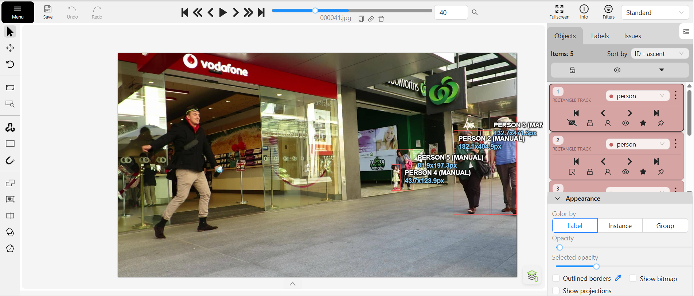

# Báo cáo cá nhân — NguyenXuanAnh-2A202603101

Đoạn video: MOT17-09, 150 frame (frame 1–150), nguồn MOTChallenge, giấy phép CC BY-NC-SA 3.0.

## 0. Thông tin học viên

- Họ tên: Nguyễn Xuân Anh
- MSSV: 2A202603101
- Mã đề (A/B/C): B
- Email: 26ai.anhnx@vinuni.edu.vn
- Link repository: https://github.com/VinUni-AI20k/K5-L2-DAY05-NguyenXuanAnh-2A202603101-MOTTracking
- Giờ bắt đầu: 17:00
- Giờ kết thúc: 18:30

## 1. Xem trước đoạn video (CP0)

Ghi **trước khi vẽ**, mỗi người một dòng.

| Mã | Frame xuất hiện | Frame cuối thấy được | Rẽ / dừng / đổi tốc độ ở frame | Bị che ở frame | Ghi chú |
|---|---|---|---|---|---|
| P1 | 0 | 149 | ~30 | 30–49 | Bị che bởi vật thể khác, mất hẳn 10 frame (frame 40–49) |
| P2 | 0 | 149 | — | — | Đi thẳng đều suốt đoạn, không bị che |
| P3 | 0 | 149 | — | Có 70 frame occluded | Bị che một phần bởi vật cản/người đi ngang qua |
| P4 | 0 | 148 | ~80 | 110–139 | Đổi hướng/tốc độ quanh frame 80, khuất/vắng ở frame 110–139 |
| P5 | 0 | 139 | ~80 | 110–138 | Bị che một phần (20 frame occluded) và mất hẳn ở frame 110–138 |

## 2. Keyframe và thời gian (CP1, CP4)

Số keyframe lấy từ kết quả `src/check_submission.py`.

| Mã | Số keyframe | Keyframe ở frame | Số frame có mặt | Keyframe / 100 frame | Thời gian (phút) | Chỗ khó |
|---|---|---|---|---|---|---|
| P1 | 15 | 0, 10, 20, 30, 50, 60, 70, 80, 90, 100, 110, 120, 130, 140, 149 | 140 | 10.7 | ~10 | Đoạn bị che frame 40–49, cần occluded + outside |
| P2 | 16 | 0, 10, 20, 30, 40, 50, 60, 70, 80, 90, 100, 110, 120, 130, 140, 149 | 150 | 10.7 | ~8 | Đi thẳng, ít khó |
| P3 | 16 | 0, 10, 20, 30, 40, 50, 60, 70, 80, 90, 100, 110, 120, 130, 140, 149 | 150 | 10.7 | ~10 | Có 70 frame bị che một phần (occluded) |
| P4 | 10 | 0, 10, 20, 30, 40, 50, 60, 70, 80, 140 | 119 | 8.4 | ~10 | Đoạn vắng outside frame 110–139, đổi hướng |
| P5 | 10 | 0, 10, 20, 30, 40, 50, 80, 90, 100, 139 | 111 | 9.0 | ~12 | Bị che 20 frame occluded và đoạn vắng 110–138 |
| **Tổng** | **67** | — | **670** | **10.0** | ~50 | |

Keyframe / 100 frame của cả bài = 67 ÷ 670 × 100 = **10.0 keyframe / 100 frame**

Bạn đặt keyframe nhiều nhất ở người nào? Vì sao (người đó rẽ, dừng, lại gần camera hay bị che)?

Đặt keyframe nhiều nhất ở P2, P3 (16 keyframe) và P1 (15 keyframe). P1 cần nhiều keyframe ở quanh đoạn bị che (trước khi mất hẳn frame 30 và ngay khi hiện lại frame 50) để nội suy không bị sai lệch vị trí. P2 và P3 duy trì keyframe đều mỗi 10 frame để bám sát chuyển động liên tục trong toàn bộ 150 frame. P4 và P5 có đoạn outside (vắng mặt gần 30 frame) nên số keyframe ít hơn nhưng tập trung ở các mốc rẽ/đổi tốc độ và quanh đoạn khuất.

## 3. Đoạn bị che (CP2)

Người bị che: `P1`

| Mốc | Frame |
|---|---:|
| Bắt đầu bị che một phần (bật `occluded`) | ~30 |
| Mất hẳn (bật `outside`) | 40 |
| Hiện lại (tắt `outside`) | 50 |
| Thấy rõ trở lại (tắt `occluded`) | ~50 |

- Thời gian khuất hẳn: **10 frame = 0.33 giây**.
- Quyết định: **giữ cùng ID**.
- Lý do (trả lời 3 câu: khuất bao lâu so với 60 frame, ngoại hình có khớp, chỗ hiện lại có đúng hướng và tốc độ):

  1. **Khuất bao lâu so với 60 frame:** P1 khuất hẳn 10 frame (frame 40–49), tức 0.33 giây — nhỏ hơn nhiều so với ngưỡng 60 frame (2 giây) của lớp. Áp dụng quy tắc: giữ cùng ID.
  2. **Ngoại hình có khớp:** Người hiện lại ở frame 50 có cùng trang phục, dáng vóc và kích thước với P1 trước khi bị che — xác nhận đây là cùng một người.
  3. **Hướng đi và tốc độ:** Vị trí hiện lại liên tục và nhất quán với hướng di chuyển của P1 trước đó, tốc độ không có bước nhảy bất thường.

Ảnh chụp màn hình:





## 4. Tự review ID (CP3)

Lượt 1 theo người (đi ngược từ frame 149 về 0 trên CVAT), lượt 2 theo cảnh (nhảy 10 frame). Ít nhất 3 dòng; không có lỗi thì ghi một dòng "đã kiểm hai lượt, không lỗi".

Loại lỗi dùng đúng một trong 7 mã: `id_switch`, `fragmentation`, `lost`, `merge`, `false_track`, `drift`, `flag`.

| Frame | Mã người | Loại lỗi | Mô tả một câu | Phát hiện ở lượt | Đã sửa? |
|---:|---|---|---|---|---|
| 110–139 | P4 | `flag` | Thiếu cờ outside khi người bị khuất/ra ngoài khung ở frame 110–139 | Lượt 1 | Đã sửa: bật outside từ frame 110 và tắt khi xuất hiện lại ở frame 140 |
| 110–138 | P5 | `flag` | Thiếu cờ outside khi người bị che khuất hoàn toàn ở frame 110–138 | Lượt 1 | Đã sửa: bật outside frame 110–138 và gán occluded cho các frame bị che một phần |
| ~50–120 | P3 | `flag` | Chưa bật cờ occluded khi người bị che một phần thân bởi chướng ngại vật/người khác | Lượt 2 | Đã sửa: bật cờ occluded (70 frame) và giữ box toàn thân ước lượng |

Tổng hợp số lỗi theo loại:

| `id_switch` | `fragmentation` | `lost` | `merge` | `false_track` | `drift` | `flag` |
|---:|---:|---:|---:|---:|---:|---:|
| 0 | 0 | 0 | 0 | 0 | 0 | 3 |

Lỗi nào chỉ lượt 2 (theo cảnh) mới thấy, lượt 1 (theo người) không thấy? Vì sao?

Lỗi `flag` (thiếu occluded) ở P3 và các tình huống che một phần: khi duyệt lượt 1 (theo từng người), người gán nhãn dễ bị tập trung theo dõi biên dạng của riêng đối tượng đó mà không nhận ra có người khác hoặc vật thể trong bối cảnh đang che khuất một phần thân thể họ. Đến lượt 2 (theo cảnh), quan sát tổng thể tất cả các đối tượng tương tác với nhau trong khung hình mới dễ dàng phát hiện sự giao cắt và chồng lấn để bật cờ `occluded`.

## 5. File xuất và kết quả tự kiểm (CP4)

| Kiểm tra | Kết quả |
|---|---|
| Tên file MOT 1.1 | `NguyenXuanAnh_mot.zip` |
| Tên file CVAT for video 1.1 | `NguyenXuanAnh_cvat_video.zip` |
| Số track ID khác nhau trong `gt/gt.txt` (phải là 5) | 5 ✅ |
| Frame `outside` không có dòng trong `gt.txt` (đúng / sai) | Đúng ✅ |
| Job đã completed trên CVAT máy cá nhân | Đã completed ✅ |

Dán phần tóm tắt in ra từ `src/check_submission.py`:

```text
Số frame in theo CVAT (bắt đầu từ 0). Trong gt.txt, frame_id = frame CVAT + 1.

=== File MOT 1.1: NguyenXuanAnh_mot.zip ===
  Số track ID: 5   |   Tổng số box: 670
  [OK]        Đúng 5 track ID.

  Track | Frame có mặt | Số frame | Đoạn vắng (outside)
      1 |   0–149      |      140 | 40–49
      2 |   0–149      |      150 | -
      3 |   0–149      |      150 | -
      4 |   0–148      |      119 | 110–139
      5 |   0–139      |      111 | 110–138


=== File CVAT for video 1.1: NguyenXuanAnh_cvat_video.zip ===

  Track | Nhãn   | Frame thấy | Keyframe | KF/100 frame | Frame occluded | Lần bật outside
      0 | person |        140 |       15 |         10.7 |             50 |               1
              Track 0: keyframe ở frame [0, 10, 20, 30, 50, 60, 70, 80, 90, 100, 110, 120, 130, 140, 149]
      1 | person |        150 |       16 |         10.7 |              0 |               0
              Track 1: keyframe ở frame [0, 10, 20, 30, 40, 50, 60, 70, 80, 90, 100, 110, 120, 130, 140, 149]
      2 | person |        150 |       16 |         10.7 |             70 |               0
              Track 2: keyframe ở frame [0, 10, 20, 30, 40, 50, 60, 70, 80, 90, 100, 110, 120, 130, 140, 149]
      3 | person |        119 |       10 |          8.4 |              0 |               2
              Track 3: keyframe ở frame [0, 10, 20, 30, 40, 50, 60, 70, 80, 140]
      4 | person |        111 |       10 |          9.0 |             20 |               2
              Track 4: keyframe ở frame [0, 10, 20, 30, 40, 50, 80, 90, 100, 139]

  Tổng: 67 keyframe / 670 frame có mặt = 10.0 keyframe / 100 frame
  [OK]        Đọc được 5 track từ annotations.xml.

=== Tóm tắt ===
  Lỗi: 0   |   Cảnh báo: 0
  Đạt. Dán phần tóm tắt này vào báo cáo mục 5.
```

## 6. Ba câu kết

1. Nếu được gán lại, bạn sẽ đặt keyframe khác ở đâu? Vì sao?

   Nếu gán lại, tôi sẽ giảm bớt keyframe đều đặn mỗi 10 frame ở các đoạn đi thẳng (như P2) và thay bằng keyframe thưa hơn (mỗi 20–30 frame), đồng thời dồn keyframe dày hơn ở các đoạn rẽ và thay đổi tốc độ của P4, P5 cũng như quanh các đoạn khuất của P1, P4, P5. Lý do là nội suy tuyến tính chỉ sai khi chuyển động thay đổi, còn đi thẳng đều thì đặt ít keyframe vẫn chính xác và tiết kiệm thời gian gán nhãn đáng kể.

2. Có chỗ nào bạn không chắc "cùng ID hay ID mới"? Bạn đã quyết định và ghi chú thế nào?

   Các đoạn khuất của P1 (frame 40–49), P4 (frame 110–139) và P5 (frame 110–138) là những chỗ cần cân nhắc. Tôi áp dụng 3 câu hỏi theo guideline của lớp:
   - Thời gian khuất: P1 khuất 10 frame (0.33s), P4 khuất 30 frame (1s), P5 khuất 29 frame (~1s) — tất cả đều dưới ngưỡng 60 frame (2 giây).
   - Ngoại hình: quần áo, vóc dáng của từng người khi xuất hiện lại hoàn toàn trùng khớp với trước khi bị che.
   - Vị trí và vận tốc: vị trí xuất hiện lại hoàn toàn phù hợp với hướng đi và tốc độ trước đó.
   Vì vậy, quyết định giữ cùng ID (bật outside khi mất và tắt outside khi hiện lại) là chính xác theo chuẩn ground truth.

3. Một lỗi ID trong job của bạn (nếu không còn sót, chọn lỗi đã sửa) có thể làm xe tự lái dự đoán sai chuyển động của người đó như thế nào? Lỗi đó ảnh hưởng MOTA hay IDF1 nhiều hơn?

   Nếu P1 hoặc P4/P5 khi bị che không dùng cờ `outside` mà vô tình bị gán nhảy ID (`id_switch`) sang người khác, bộ lọc tracking (Kalman Filter) sẽ tính toán ra một vector vận tốc nhảy vọt bất thường (ví dụ di chuyển vài mét trong 1/30s ≈ hơn 100 km/h). Xe tự lái sẽ dự đoán sai hoàn toàn quỹ đạo tương lai của đối tượng, dẫn đến quyết định nguy hiểm như phanh gấp sai lầm hoặc chuyển làn va chạm. Lỗi này ảnh hưởng **IDF1 nhiều hơn MOTA** vì IDF1 đánh giá tính nhất quán danh tính xuyên suốt toàn bộ hành trình (identity consistency), trong khi MOTA chủ yếu đếm số lỗi phát hiện tức thời và chỉ phạt 1 điểm cho mỗi lần switch ID.

## Bonus (nếu làm)

Không thực hiện bonus.

## 7. Tài liệu tham khảo và công cụ AI đã dùng

- MOT17: Milan et al. (2016), MOTChallenge, giấy phép CC BY-NC-SA 3.0. Nguồn ảnh: MOT17, MOTChallenge (Milan et al., 2016).
- CVAT Community: annotation tool, https://cvat.ai
- Tài liệu hướng dẫn trong repo: `docs/GUIDELINE.md`, `docs/CVAT_CHEATSHEET.md`, `CHECKPOINTS.md`
- Công cụ AI: Antigravity (hỗ trợ đọc và hiểu yêu cầu bài lab, cập nhật báo cáo và phân tích kết quả script tự kiểm tra).
